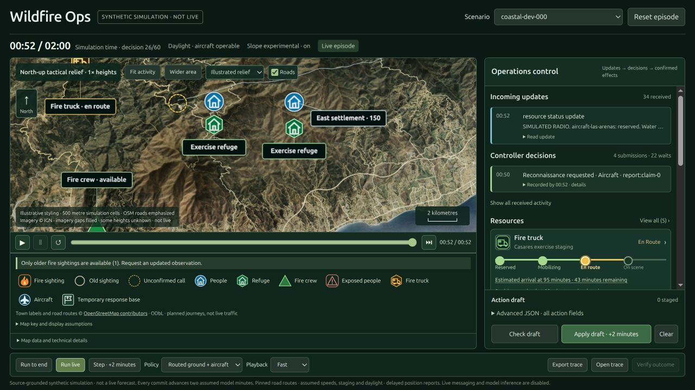

# Wildfire Response Environment

Run a simulated wildfire response from an operations control centre: read delayed
reports, investigate uncertainty, coordinate crews and aircraft, and issue
population-protection orders. The environment runs on CPU and is not connected
to real dispatch or emergency systems.



*The coastal/benchmark dashboard; the incident-day prototype has a separate interface.*

## The task

The **incident-day v2 prototype** begins at a large-fire handover and runs up to
24 simulated hours. The agent sees delivered reports, known resource status,
approaches and population information, rather than future events or private audit
state. It can inspect reports and routes, check draft actions, commit resource and
protection orders, request status, and wait for new information. Orders and status
requests take a minute; waiting stops early for actionable events or deadlines.

Its twenty fixture development cases span six families, including separately versioned
finite-shift, withdrawal, crew-access and relocation exercises. They use a
synthetic fixture, not
historical incident replays or a held-out evaluation set. The original six
`incident-day-dev-*` cases retain ineffective inherited ground assignments for
regression; use the explicit egress/coverage IDs below for fixture exercises. The separate, frozen
**benchmark v1** runs up to 120 minutes in two-minute turns, with 80 train, 20
validation and 20 test configuration groups and separate development probes.
The coastal dashboard uses benchmark/coastal mobility mode; it does not show an
incident-day run. See [incident-day](docs/incident-day.md),
[benchmark](data/benchmark_v1/README.md) and [coastal mobility](docs/mobility.md).

## Score and limits

Two six-case real-map suites require the pinned estimated map pack. The current
`incident-day-realmap-v2-*` suite exercises screened road corridors, wind rerouting,
crew-only work and evacuation relocation. Crews must travel, set up, work and
return. Its six full-day runs pass exact replay and independent accounting; the
earlier v1 cases remain available. Placements are synthetic, not historical
deployments. See the [real-map guide](docs/incident-day.md).

At completion, the day reward is `0.8 × newly protected population fraction +
0.2 × fraction of remaining burnable cells not newly burned`. Inherited exposure
and burned area are excluded; abandoned runs score zero and censored runs cannot
earn a successful day score. The frozen benchmark also uses an 80/20 population
and unburned-area reward, with its own accounting and ranking rules. Replay and
independent accounting verify a run, not the physical accuracy of its assumptions.
Simulated exposure is not a death count.

The day fixture, weather, roster and operational parameters are synthetic. Real
source-pack approval is blocked by 80 unknown fuel cells; estimated values do not
resolve that gate. The road network is incomplete. No model has demonstrated a
verified training improvement; the development dispatcher is not an optimal policy.
See [fidelity](docs/fidelity.md) and [day data](data/incident_day_v2/README.md).

## Try it on CPU

From a fresh clone, with Python 3.12 or newer, run the bundled withdrawal fixture.
This first step needs no prepared data, model, API key, GPU or extra packages:

```sh
PYTHONPATH=envs/wildfire_response/core/src python3 - <<'PY'
from wildfire_core.incident_day import IncidentDayEnv, IncidentDayTools, fixture_inputs

inputs, network = fixture_inputs()
env = IncidentDayEnv(inputs, network, expected_inputs_sha256=inputs['sha256'],
                     expected_network_sha256=network['sha256'])
observation, info = env.reset('incident-day-egress-v1-000')
tools = IncidentDayTools(env)
print('Horizon:', observation['clock']['horizon_minutes'], 'minutes')
result = tools.execute('advance_time', {'max_minutes': 10})
print('Minute:', result['observation']['minute'], 'reward:', result['reward'])
PY
```

For a full CPU acceptance run and optional client, see the
[day guide](docs/incident-day.md). The older benchmark requires separately
prepared, checksum-pinned inputs; follow [data storage](docs/data-storage.md)
and the [benchmark commands](data/benchmark_v1/README.md).

## Repository

- `envs/wildfire_response/core/` — simulator, tools and verification.
- `envs/wildfire_response/openenv/` — optional client/server adapter.
- `data/` and `docs/` — fixtures, manifests, source notes and reference cards.
- `eval/`, `results/` and `train/` — evaluation, reports and gated training work.
- `ui/` — local coastal/benchmark control-centre dashboard; see the [UI guide](ui/README.md).

Read the [environment card](docs/environment.md), [dataset card](docs/dataset-card.md),
[provenance](docs/provenance.md) and [license status](docs/license-status.md)
before reuse or distribution. Code and asset rights remain under review.
